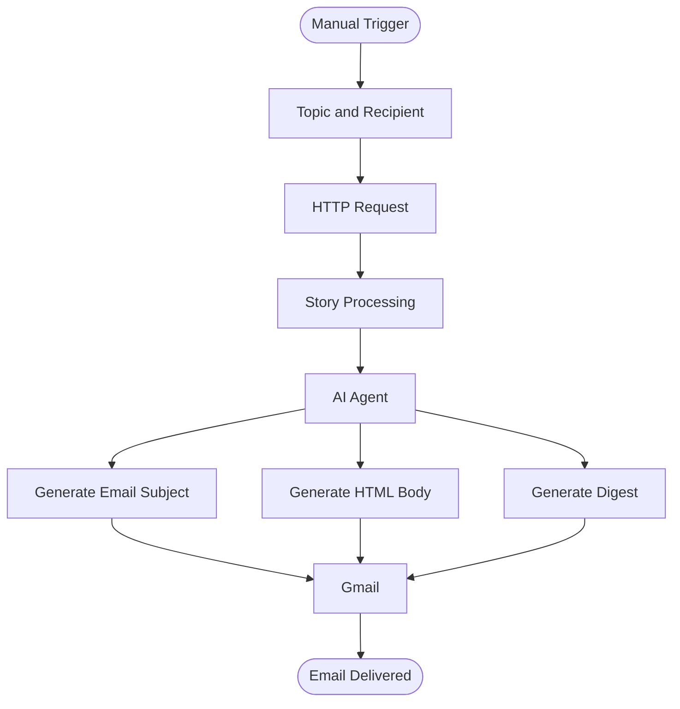

# DevPulse
### Your Daily Pulse on Technology.

**Discover. Curate. Understand. Deliver.**

DevPulse is an AI-powered technology news digest automation built using **UiPath**. It takes technology stories, processes them, uses an AI Agent to generate an organized email digest, and delivers the result through Gmail.

Instead of manually browsing through multiple technology updates, DevPulse automates the journey from discovering stories to receiving a curated email.

---

## Overview

Keeping up with the rapidly evolving technology ecosystem can be time-consuming. DevPulse aims to simplify that process through an automated workflow that combines data retrieval, processing, AI-powered content generation, and email delivery.

The automation accepts a topic and recipient as inputs, retrieves relevant stories, processes the collected information, and passes it to an AI Agent.

The agent generates an email subject, HTML-formatted email body, and digest output, which are then used in the email delivery stage.

## How It Works

The automation follows four major stages:

| Stage | Process |
|---|---|
| 01 — Input | Accepts a technology topic and recipient email through a manual trigger. |
| 02 — Discovery | Retrieves technology stories through an HTTP request. |
| 03 — Intelligence | Processes the stories and sends the collected information to an AI Agent. |
| 04 — Delivery | Generates the email content and sends the digest through Gmail. |

### Workflow Architecture



## Key Features

- **Topic-based input:** Choose the technology topic for the digest.
- **Automated story retrieval:** Fetches technology stories through an HTTP request.
- **Story processing:** Organizes retrieved information before AI processing.
- **AI-powered generation:** Uses an autonomous AI Agent to generate structured email content.
- **HTML email formatting:** Produces an HTML-based email body.
- **Gmail integration:** Delivers the generated digest through Gmail.
- **Configurable recipient:** Specify the destination email address when triggering the workflow.

## Technology Stack

| Technology | Purpose |
|---|---|
| UiPath | Workflow orchestration and automation |
| UiPath HTTP Request | Story retrieval |
| UiPath AI Agent | Intelligent digest generation |
| Gmail Integration | Email delivery |
| JSON | Structured data exchange |

## Project Structure

```text
DevPulse/
│
├── Flow/
│   └── Workflow and agent configuration
│
├── resources/
│   └── solution_folder/
│       └── package/
│
├── EmailAutomation1 - GitHub.uipx
├── SolutionStorage.json
├── .gitignore
└── README.md
```

## Getting Started

### Prerequisites

- UiPath Studio with support for the project format.
- Access to the required UiPath packages and integrations.
- A Gmail account for email delivery.
- Access to the AI Agent configuration used by the workflow.

### Setup

1. Clone this repository:

   ```bash
   git clone https://github.com/vanya4-beep/Devpulse.git
   ```

2. Open the downloaded project using UiPath Studio.

3. Restore the required dependencies and packages.

4. Configure the required HTTP Request and AI Agent resources.

5. Set up your own Gmail integration in UiPath.

6. Configure the Gmail connection and its resource reference according to your UiPath environment.

7. Run the automation using the manual trigger.

8. Enter your desired topic and recipient email address.

> **Note:** Your UiPath connections and credentials are environment-specific. You will need to configure your own integrations before running the automation. The exact project-import and connection setup instructions will be expanded as the project documentation is completed.

## Screenshots

Screenshots of the UiPath workflow, agent configuration, and generated email output will be added here.

## Future Improvements

- More configurable technology categories.
- Improved story relevance and filtering.
- Duplicate-story detection.
- Enhanced digest formatting.
- Scheduling and automated delivery.
- Additional output and delivery options.

## Author

**Vanya Mehrotra**

B.Tech — Computer Science and Information Technology

- GitHub: [@vanya4-beep](https://github.com/vanya4-beep)
- LinkedIn: [Vanya Mehrotra](https://www.linkedin.com/in/vanya-mehrotra-4b98b8412/)

---

<p align="center">
  <b>DevPulse — Stay curious. Stay informed.</b>
</p>
